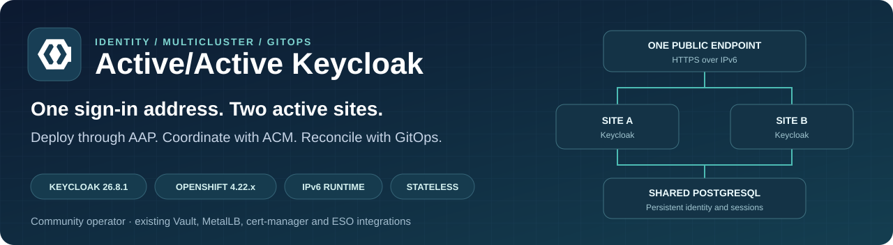
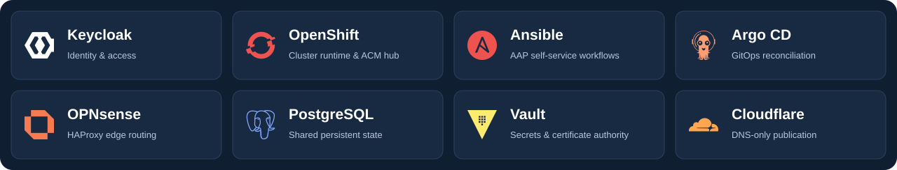

<p align="center">
  
</p>

<h1 align="center">Active/Active Keycloak</h1>

<p align="center">
  <strong>Self-service identity infrastructure for two OpenShift sites.</strong><br />
  One public endpoint · Shared PostgreSQL · IPv6 · GitOps
</p>

<p align="center">
  <a href="docs/deployment-readiness.md"></a>
  <a href="docs/deployment-readiness.md"></a>
  <a href="docs/ha-acceptance.md"></a>
</p>

<p align="center">
  Reference implementation status · Static badges, not live monitoring
</p>

<p align="center">
  <a href="docs/CONFIGURATION.md"><strong>Configure</strong></a> ·
  <a href="docs/deployment.md"><strong>Deploy</strong></a> ·
  <a href="automation/aap/SELF-SERVICE.md"><strong>Survey</strong></a> ·
  <a href="docs/architecture.md"><strong>Architecture</strong></a> ·
  <a href="automation/aap/REMOVAL.md"><strong>Remove</strong></a> ·
  <a href="docs/deployment-readiness.md"><strong>Readiness</strong></a>
</p>

---

Community Keycloak **26.8.1** runs in stateless mode on two **OpenShift 4.22.x** clusters with a shared PostgreSQL database. OPNsense HAProxy sends IPv6 HTTPS traffic to healthy sites. AAP coordinates deployment through the ACM hub and Argo CD, reusing existing MetalLB, cert-manager and Vault/ESO integrations.

> **Public starter configuration.** Source, manifests, diagrams and JSON use examples or placeholders. Deployment and removal are disabled by default. Start with the [configuration guide](docs/CONFIGURATION.md) to prepare your private deployment fork; keep credentials in Vault and AAP.

## Built with



Existing **MetalLB**, **cert-manager** and **External Secrets Operator** integrations provide backend addresses, certificates and Kubernetes Secrets. [Logo sources and asset notes](docs/assets/README.md).

## Choose your next step

| I want to… | Start here |
| --- | --- |
| Configure the JSON files and platform | [Configuration guide](docs/CONFIGURATION.md) |
| Deploy a new Keycloak instance | [Deployment guide](docs/deployment.md#launch-a-deployment) |
| Understand or fill out the survey | [Seven deployment inputs](automation/aap/SELF-SERVICE.md#deployment-survey) |
| Connect an application | [Client flow and endpoints](docs/architecture.md#client-endpoints) |
| Retry a failed workflow | [Troubleshooting and retry](docs/deployment.md#retry-a-failed-installation) |
| Remove an installation | [Removal guide](automation/aap/REMOVAL.md#start-with-a-plan) |
| Test high availability | [HA acceptance plan](docs/ha-acceptance.md) |
| Prepare another platform | [Platform setup](automation/aap/README.md) and [ACM integration](automation/acm/README.md) |

## How traffic reaches Keycloak


[View full-size architecture](docs/diagrams/architecture.svg)

1. The client resolves `auth.example.com` through **Cloudflare DNS**.
2. It connects directly to the **OPNsense IPv6 VIP** on HTTPS/443. Cloudflare is DNS-only.
3. **HAProxy** terminates client TLS and opens a verified TLS connection to a healthy site's MetalLB service.
4. **Keycloak** authenticates the request using the shared PostgreSQL database. Both sites present the same public issuer.

Clients need IPv6 connectivity and trust in the certificate issuer. Managed sites are IPv6-only; the ACM/AAP hub can be dual stack. Availability also depends on the database and edge infrastructure.

## Deploy with seven inputs

After platform configuration and commissioning, open **Keycloak Active Active Self Service** in AAP and launch a new job.

| Survey input | Example |
| --- | --- |
| Managed cluster A | `cluster-a` |
| Managed cluster B | `cluster-b` |
| Public FQDN | `auth.example.com` |
| Public IPv6 VIP | `PUBLIC_IPV6_VIP` |
| Namespace on both sites | `keycloak` |
| Vault database secret path | `global/tenant-a/postgresql` |
| PostgreSQL TLS | `enabled` when your database supports trusted TLS; otherwise explicitly choose `disabled` |

The workflow runs **Discover → Plan → Deploy**. It discovers backend addresses and existing integrations, installs Keycloak on both sites, configures the project’s HAProxy objects, verifies authentication, and publishes the owned DNS record. Supply an existing dedicated database; the workflow does not create it. Each independent installation needs its own namespace, hostname, VIP and database.

You do not need to enter managed-cluster passwords, MetalLB backend IPs, router source networks or a bootstrap administrator Vault path. See the [survey reference](automation/aap/SELF-SERVICE.md) for discovery behavior and the exact secret schema.

## How users sign in


[View full-size client journey](docs/diagrams/client-access.svg)

The example uses Authorization Code + PKCE. Browser sign-in and the application's token exchange use the same Keycloak hostname. Application traffic follows the application's own route. [Client access](docs/architecture.md) explains the endpoints and TLS boundaries.

## Validation status

The badges describe the private reference implementation. They do not query AAP or the clusters, and do not certify a new installation from this public copy.

| Area | Recorded status | What it means |
| --- | --- | --- |
| Deployment | **Verified** | The reference installation completed deployment workflows. |
| Removal | **Verified** | One deployed Keycloak installation was successfully removed, as confirmed by the user. |
| HA acceptance | **Runbook provided** | [Test procedures and pass criteria](docs/ha-acceptance.md) are documented; execution and validation remain outstanding. |
| Certificate renewal | **Commissioning needed** | Deployment imports certificates; continuous edge renewal delivery is not yet scheduled. |

See the [readiness report](docs/deployment-readiness.md) for evidence and limits. A successful deployment does not establish production HA acceptance.

## Explore the repository

| Area | Purpose |
| --- | --- |
| [AAP automation](automation/aap/README.md) | Surveys, workflow registration and execution environment |
| [ACM](automation/acm/README.md) / [hub resources](gitops/hub/README.md) | Cluster selection, registration and GitOps permissions |
| [Operator](gitops/operator/kustomization.yaml) / [site A](gitops/keycloak/overlays/cluster-a/kustomization.yaml) / [site B](gitops/keycloak/overlays/cluster-b/kustomization.yaml) | Kubernetes configuration |
| [Argo Applications](gitops/applications/applications.yaml) | Operator, prerequisites and runtime per site |
| [OPNsense](automation/opnsense/README.md) / [DNS template](automation/cloudflare/record.json) | Edge and DNS integration |
| [Environment](docs/environment-audit.md), [Vault](docs/vault-audit.md), [AAP credentials](docs/aap-credential-audit.md) | Platform inventory and credential requirements |

## Local preview

Render the Kubernetes configuration locally without contacting a cluster:

```sh
kubectl kustomize gitops/operator
kubectl kustomize gitops/keycloak/prerequisites
kubectl kustomize gitops/keycloak/overlays/cluster-a
kubectl kustomize gitops/keycloak/overlays/cluster-b
```

Raw manifests contain placeholders and platform-specific configuration. Use the automatic workflow to supply discovered values and coordinate synchronization. The diagrams are editable SVGs with no external image or font dependencies.

---

<p align="center">Two sites. One identity endpoint. Every change reviewed in Git.</p>
