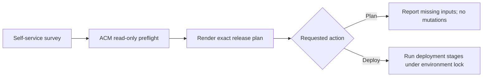

# Self-service workflow implementation

> **Documentation examples:** names, domains and IP addresses are anonymized. Use your own environment values; see [example conventions](../../docs/examples.md).

> **Legacy implementation notes.** This page records the earlier manual workflow and historical gate state. Use [SELF-SERVICE.md](SELF-SERVICE.md) and [the deployment guide](../../docs/deployment.md) for current operations.

> Historical manual runner interface. Registered workflows now use automatic discovery and the seven-field deployment survey; see [SELF-SERVICE.md](SELF-SERVICE.md) for the current contract.

The repository contains executable preparation and deployment code plus a controller-configuration playbook. Deployment workflow **16** and removal workflow **20**, including both surveys, are installed in AAP under Project **12**. Neither application workflow has been launched. The Git profile has `execution_enabled: false`, and the survey defaults to **Plan**.

## Survey

[controller/survey.json](controller/survey.json) contains request metadata and the complete non-secret deployment parameters. See [the self-service contract](SELF-SERVICE.md) for each input, the managed-cluster ESO Secret schema, ACM credential discovery, and platform prerequisites. Targets remain the approved pair `cluster-a` + `cluster-b`.

## Controller graph



`playbooks/configure-controller.yml` creates or updates three Job Templates, one Workflow Job Template, its survey, and success-only graph edges. It never launches the workflow. The workflow forbids simultaneous launches; the deployment runner additionally holds a hub ConfigMap lock for the full mutating job. An existing lock is never silently stolen. If AAP kills the job, inspect the recorded run ID and any still-running processes before an administrator removes the stale lock.

The plan job and execute job each copy available SCM history into an isolated checkout and check out the survey SHA. There is no mutable shared artifact dependency between AAP execution environments. The requested commit must exist in the SCM project's local history; sync the AAP Project after pushing the reviewed commit. The runner verifies HEAD and clean working-tree state. Uncommitted IDE edits cannot be deployed through this workflow.

## Deployment stages

The runner is [scripts/deploy.py](../../scripts/deploy.py). All stages fail closed; a failed stage prevents later stages.

1. Resolve the committed profile, render manifests, and reject unresolved values or inconsistent hostname/backend configuration. Validate database trust PEM, IPv6 ingress CIDRs, TLS verification settings, and version expectations.
2. Load hub authentication, discover managed access through ACM, verify destinations and acquire the environment lock. External credentials are loaded only after prerequisites sync.
3. Check the two managed clusters, existing operator/runtime versions, Vault issuer readiness, and Vault store readiness. Version changes are rejected; this is not an upgrade workflow.
4. Apply hub registration, AppProject, and six manual-sync Applications. Wait for exact placement identities and both registered API endpoints.
5. Sync each operator Application, inspect the Subscription-referenced InstallPlan, approve only the expected single CSV with resourceVersion protection, and wait for CSV Succeeded.
6. Sync separate prerequisites Applications; wait for certificate and ExternalSecret readiness and nonempty Secret keys. Compare the two database Secret mappings in memory without logging their contents. Then wait for the managed automation ExternalSecret and read its Secret from cluster-a.
7. Sync cluster A, wait for Keycloak Ready and `/lb-check`, then bootstrap or verify permanent administrative access.
8. Sync cluster B and run discovery and client-credentials authentication checks against its backend with verified TLS/SNI.
9. Reconcile only the named HAProxy objects, resolve their UUID references, validate the generated configuration, enable HAProxy if needed, and reconfigure through the plugin API. Test the public VIP before DNS publication using SNI with an explicit IPv6 connection target.
10. Reconcile the DNS-only AAAA record, respecting ownership, then verify public IPv6 resolution, discovery issuer, and synthetic token issuance.
11. Report success only after the final check. Release the lock with a UID deletion precondition even on ordinary failures.

Argo CD writes managed-cluster application desired state. AAP applies hub resources and requests transient Argo sync operations; it does not directly apply workload manifests. Each sync is correlated with this run ID so an earlier successful operation cannot satisfy the current gate. Prune and forced sync are not enabled.

## Initial administrator bootstrap

Permanent administrator credentials and a synthetic client secret are read from the managed-cluster ESO-managed Secret. The runner first tries permanent administrator login. On initial installation only, if that fails, it reads `keycloak-bootstrap` in cluster A, creates a distinct permanent administrator, assigns the master realm admin role, verifies access, and deletes the temporary bootstrap user. It never resets an existing administrator's password. If the permanent user exists but login fails, the workflow stops for recovery.

The runner creates `keycloak-deployment-smoke` in the master realm on initial install, with client credentials enabled and no assigned administrative roles. Subsequent runs reuse it without resetting its secret. Reconcile fails if permanent admin or synthetic-client access is unavailable. Store both credential sets durably in Vault before first use. ESO bootstrap material remains in the namespace until a separately reviewed Git change removes that reference; deleting the temporary Keycloak user does not delete its Kubernetes Secret.

Smoke checks prove discovery and token issuance through each site, the VIP, and public DNS. They do not prove browser login, logout propagation, refresh-token failover, or database failover. Those require the separate acceptance exercise in the deployment plan.

## Reproducing the workflow registration

1. Commit and push the completed repository. Create/sync an AAP SCM Project using its private Git credential and trusted CA; create an inventory containing localhost and a suitable execution environment.
2. Reuse existing hub credential **4** without modifying its type or values. The credential-type JSON files are optional schemas for other environments. External credentials are read through the managed clusters' existing ESO integration.
3. Copy `controller/settings.example.yml` outside the repository and fill the existing organization, project, inventory, execution-environment, and credential IDs. Confirm the gateway controller API base for AAP 2.7.
4. Inject `CONTROLLER_OAUTH_TOKEN` for a configuration account. Run `playbooks/configure-controller.yml` with the reviewed settings and `configure_controller=true` when controller changes are authorized. It configures but does not launch anything.
5. Grant the intended users workflow execute permission. Do not grant survey users permission to edit the SCM Project, Job Templates, credential types, or workflow graph. A reviewed repository and trusted commit-selection policy are part of the execution boundary.
6. Run Plan first. Resolve all inputs, test against the installed APIs, then enable deployment by a reviewed profile commit. Launch Deploy with that exact SHA when deployment is authorized.

The controller configuration uses the REST API and built-in Ansible modules; no Galaxy controller collection is required. Both controller registration playbooks completed against the live AAP API. Deployment/removal behavior against the external systems remains untested.

## Execution environment and credentials

Provide Python 3.9+, ansible-core, Git, `oc`, `kubectl` with Kustomize, trusted platform CAs, and [requirements.txt](requirements.txt). Pin the execution-environment image and tools for production. No token is accepted through CLI arguments or survey fields. The preflight uses its own read-only hub credential; the plan template has no infrastructure credentials.

The deployment credential injects `KUBECONFIG` (hub only) and `KEYCLOAK_REPORT_DIR` (a persistent mounted directory outside the checkout). Managed access comes from existing ACM ManagedServiceAccounts. Trust bundles and external API credentials come from the managed-cluster ESO-managed Secret described in [SELF-SERVICE.md](SELF-SERVICE.md).

The runner writes a per-run recovery journal with mode 0600: stage history, prior fields for touched HAProxy objects, newly created object identities, and prior DNS records. It never writes database passwords, administrator passwords, or OAuth tokens. Restrict journal access because configuration can be sensitive. Configure artifact retention on the persistent volume; temporary execution-environment storage is insufficient.

Hub permissions must cover reading ACM managed token Secrets, reading ACM/Argo state, registration and AppProject/Application changes, transient Application operations, and the one lock ConfigMap. Managed-cluster permissions cover readiness reads, the two named application Secrets, and approval of the referenced OLM InstallPlan. Do not use the human administrator credential from the audit as the production credential. Kubernetes Secret-read permission can expose complete data even when the program outputs none; review RBAC accordingly.

## Failure and recovery

Failures stop subsequent changes and produce a sanitized stage report. No generic database rollback, namespace deletion, forced operator downgrade, or automatic DNS deletion occurs. Review the persistent journal before compensation. HAProxy settings are saved before configtest; a failed validation can leave staged settings even though reload was not attempted. Restore only the touched fields/objects from the journal, rerun configtest, then reconfigure after review. Do not overwrite the entire firewall configuration.

If final public verification fails after DNS changed, the record remains for investigation; use the journal to decide whether to restore it. Production failure-injection remains outside the deployment workflow. Destructive decommissioning is implemented in the separate [removal workflow](REMOVAL.md). Upgrades require a separate coordinated schema/backup procedure.

## Local verification

```sh
python3 -m unittest discover -s tests -v
ansible-playbook --syntax-check automation/aap/playbooks/preflight.yml
ansible-playbook --syntax-check automation/aap/playbooks/release.yml
ansible-playbook --syntax-check automation/aap/playbooks/configure-controller.yml
```

Tests use mocked APIs and temporary Git fixtures. They do not contact infrastructure. Live AAP schema validation, OPNsense payload compatibility, RBAC/admission, database initialization, and end-to-end behavior remain commissioning checks.

## API references

- [Automation controller workflow graph](https://github.com/ansible/awx/blob/devel/docs/workflow.md)
- [Custom credential files and environment injection](https://docs.redhat.com/en/documentation/red_hat_ansible_automation_platform/2.5/html/using_automation_execution/assembly-controller-custom-credentials)
- [OPNsense HAProxy API](https://docs.opnsense.org/development/api/plugins/haproxy.html) and [upstream model](https://github.com/opnsense/plugins/blob/master/net/haproxy/src/opnsense/mvc/app/models/OPNsense/HAProxy/HAProxy.xml)
