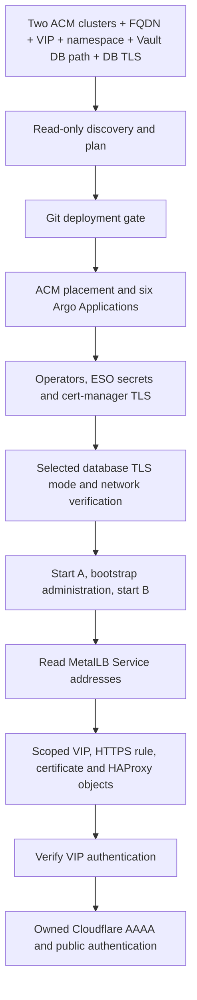

# AAP self-service Keycloak deployment

> **Documentation examples:** names, domains and IP addresses are anonymized. Use your own environment values; see [example conventions](../../docs/examples.md).

Select **cluster A, cluster B, public FQDN, its IPv6 VIP, namespace, Vault database secret path and PostgreSQL TLS mode**. The workflow discovers managed access through ACM, existing MetalLB/ESO/cert-manager configuration, router sources and Cloudflare zone. The hostname is selected at installation; shared API credential paths remain platform settings. Separate namespaces and dedicated databases allow multiple deployments on the same clusters.

For day-to-day use, open **Keycloak Active Active Self Service** to deploy, or **Keycloak Active Active Removal** to remove a recorded installation. Read the [survey reference](SELF-SERVICE.md), [deployment guide](../../docs/deployment.md) or [removal guide](REMOVAL.md). AAP assigns IDs locally; use workflow names rather than copying IDs from historical audits.

Deployment and removal were verified in the reference implementation. This public copy has both execution gates disabled and contains example configuration. Follow the [configuration guide](../../docs/CONFIGURATION.md) and [readiness checklist](../../docs/deployment-readiness.md) for your own installation.

## Platform setup

For a different AAP/ACM installation:

1. Review [platform settings](profiles/platform.json), [execution gates](profiles/active-active.json) and [controller settings](controller/settings.example.yml). Replace installation-specific values before registration.
2. Prepare hub access, [ACM registration](../acm/README.md), Argo Git access and the existing managed-cluster ESO/cert-manager integrations.
3. Build or select the [execution image](execution-environment/README.md) and configure [persistent recovery storage and the container group](../../gitops/hub/execution/README.md).
4. Register the deployment and removal workflows with their controller playbooks. Registration updates the survey and workflow graph without launching jobs.
5. Commission the execution environment, review discovery/Plan output and enable execution only for the environment you have prepared.

## Workflow at a glance

| Artifact | Purpose |
| --- | --- |
| [Survey](controller/survey.json) | Seven non-secret inputs; choices refreshed from ACM at registration |
| [Registration](playbooks/configure-controller.yml) | Update templates, survey and success-only graph without launching |
| [Release](playbooks/automatic-release.yml) | Run discovery, plan or gated deployment from the project commit |
| [Automatic runner](../../scripts/automatic.py) | Dynamic pair, manifest rendering, allocated addresses and platform integration |
| [Platform profile](profiles/platform.json) | Environment identity, shared paths, discovery preferences and administration policy |
| [Execution gates](profiles/active-active.json) | Deployment and removal disabled by default; enable separately after commissioning |
| [Removal](REMOVAL.md) | Use recorded deployment state and explicit destructive confirmations |

The earlier `release.yml`, `preflight.yml`, `survey.py` and raw manifest renderer remain as legacy manual tooling; registered workflows use the automatic playbooks. [IMPLEMENTATION.md](IMPLEMENTATION.md) describes that older interface and is retained as historical implementation detail. The current contract is SELF-SERVICE.md.
