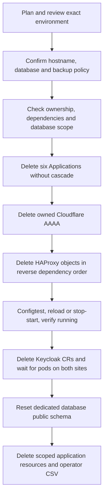

# Remove the active/active deployment

> **Documentation examples:** names, domains and IP addresses are anonymized. Use your own environment values; see [example conventions](../../docs/examples.md).

[Overview](../../README.md) · [Deploy](../../docs/deployment.md) · [Readiness](../../docs/deployment-readiness.md)

Use **Keycloak Active Active Removal** in AAP to remove one recorded installation from both clusters and empty its dedicated database. Vault credentials and unrelated applications are preserved.

**Status, 28 October 2026:** removal is enabled with explicit confirmations. Removal is **Verified** following the user’s confirmation that one deployed Keycloak installation was successfully removed. The execution environment requires `psql` and persistent recovery storage.

## Start with a plan

1. Open **Keycloak Active Active Removal** and launch a new job.
2. Select the installation's **namespace** and keep action **`plan`**. Complete the required survey fields using the actual hostname and database name.
3. Review the reported clusters, FQDN, VIP and database path. Plan reads the saved deployment record; it does not delete resources or validate a backup. Database and dependency checks run during gated removal.
4. To proceed, launch a new job with action **`remove`**, the same namespace and the confirmations below. Other applications must not reconnect to this dedicated database during the maintenance window.

## Removal survey

| Field | What to enter |
| --- | --- |
| Namespace | The namespace used for the deployment; this selects its saved ownership record |
| Action | `plan` to inspect, or `remove` to perform cleanup |
| HAProxy action | `reload` by default; `stop-start` allows a brief interruption to all apps using the shared service |
| Hostname confirmation | `REMOVE <public-hostname>`, using the hostname recorded at deployment |
| Database name | The dedicated database name, matching both sites' ESO Secrets |
| Backup policy | `verified-backup` by default, or `no-backup` with explicit data-loss acknowledgement |
| Verified backup reference | Required for `verified-backup`; a backup ID, snapshot reference or restore report you have independently checked |
| Permanent data-loss confirmation | For `no-backup`, enter `DELETE <database-name> WITHOUT BACKUP` and leave the backup reference empty |

The backup reference is your attestation: the workflow does not create or inspect a backup. See [removing without a backup](#removing-without-a-backup) for a complete example.

## What is removed and what stays

| Removed or reset | Preserved |
| --- | --- |
| Owned Keycloak workloads, application resources and operator CSVs | Other deployments, shared CRDs, platform integrations and namespaces |
| This deployment's Cloudflare AAAA and HAProxy objects | Other DNS records and HAProxy applications/settings |
| This deployment's HTTPS firewall rule | Shared certificates, trust CAs and public VIP |
| Dedicated database's `public` schema contents | Database itself, PostgreSQL login and Vault source credentials |
| Deployment record after successful cleanup | Recovery journal and unrelated ACM registrations |

The runner reads cluster identities, manifests and resource ownership from `openshift-gitops/kc-<namespace-prefix>-<namespace-hash>-state`. You do not reconstruct cluster or network settings in the removal survey. Missing/incomplete records or changed Application identities stop removal and require recovery review. The current Git profile must also have `removal_enabled: true`.

## Cleanup sequence

## Removing without a backup

The **Backup policy** defaults to `verified-backup`. Choose the policy deliberately:

| Policy | What to enter | Meaning |
| --- | --- | --- |
| `verified-backup` | A nonempty **Verified backup reference** | You attest that an independently verified restore point exists. The workflow does not inspect or create it. |
| `no-backup` | Leave **Verified backup reference** empty; enter `DELETE <database-name> WITHOUT BACKUP` in **Permanent data-loss confirmation** | You accept permanent deletion of this deployment’s database contents without a verified restore point. |

For the example database `keycloak_db`, the no-backup confirmation is exactly **`DELETE keycloak_db WITHOUT BACKUP`**. You must also supply the existing hostname confirmation, for example `REMOVE auth.example.com`, and the matching dedicated database name. A generic `yes`, a blank confirmation or a different database name is rejected before removal actions. A supplied backup reference together with `no-backup` is rejected as contradictory.

Both conditional text fields are optional in the AAP survey so either policy can be selected. The runner enforces the appropriate requirement for action `remove`; Plan reports the selected policy without claiming that a backup was verified. Selecting `no-backup` does not enable the Git removal gate, relax ownership or database-isolation checks, or alter the protections for Vault and unrelated HAProxy applications. Emptying the database deletes Keycloak realms, users, clients and sessions; retained Vault credentials cannot restore that data.

The recovery journal records the selected backup policy, reference (if any) and explicit data-loss acknowledgement. The policy is checked again immediately before the destructive SQL call. Existing callers that omit the policy retain the verified-backup requirement.

## Scope and safeguards

- Uses the selected deployment's hub ConfigMap lock and the shared firewall/reservation lock. It never steals a stale lock. The stored namespace, owner and lock identity must match; database fingerprints are checked against the recorded identity and other deployments before deletion.
- Loads external credentials from the managed-cluster ESO Secret and verifies both sites' database connection values match.
- Rejects Applications with automated sync, active operations, cascading finalizers or unexpected source/destination/project settings. Namespaced resources must appear in the corresponding Application's tracked resource inventory.
- Detaches the Applications before deleting runtime resources so Argo cannot recreate them. Deletion uses UID and resourceVersion preconditions; Application specs are journaled for recovery.
- Deletes only the matching DNS-only AAAA with the workflow ownership comment, exact hostname and VIP. Conflicting records or ExternalDNS ownership stop the operation.
- Deletes only the five allowlisted project HAProxy objects, after matching their configuration and resolving their exact UUIDs: frontend `<prefix>-public`, backend `<prefix>-backend`, servers `<prefix>-site-a` / `<prefix>-site-b`, and health check `<prefix>-health`, where `<prefix>` is derived from the selected namespace. It removes them in reverse dependency order. Another app's reference to a project UUID or object name blocks deletion; dependency checks run again immediately before deletion.
- The removal API adapter rejects global settings writes, direct restart actions, and deletion of any UUID outside the verified project inventory. The survey option `haproxy_removal_action` defaults to `reload`; selecting `stop-start` additionally permits only the service stop/start endpoints. It snapshots unrelated HAProxy settings and compares them before deletion and before reload; concurrent changes cause a refusal rather than being silently applied.
- A running shared HAProxy service is validated and reconfigured only when another enabled frontend remains. Its enable/disable setting is never changed. If removal would leave a running service with no other enabled frontend, the workflow stops during preflight before detaching Applications or deleting DNS. A valid remaining frontend is required to meet the restart requirement; temporary stop/start does not bypass this guard. An already stopped/disabled service remains stopped/disabled; saved project objects are removed without starting or reconfiguring it.
- With `stop-start`, saved project objects are deleted and the remaining configuration passes configtest before the temporary stop, keeping shared downtime short. The workflow records the restart obligation before calling stop, reconfigures, and verifies HAProxy is running before continuing with cluster/database cleanup. A `finally` handler attempts start if necessary even when stop or reconfigure fails or its response is lost. Recovery failure fails the job with an explicit shared-service recovery error; it never reports successful removal. The normal reload path also verifies running status.
- Requires Keycloak pods to disappear from **both** sites before resetting the database. Another Keycloak instance in either operator namespace blocks removal.
- PostgreSQL uses `psql` and the database credentials already supplied through ESO. The recorded database TLS choice controls `PGSSLMODE`: `verify-full` with the CA file when enabled, or `disable` without a CA dependency when disabled. Older records retain verified TLS; removal does not ask for or override this choice. A read-only SQL scope check runs before external deletion. Reset checks run again after pods stop, inside a transaction with timeouts.
- Database reset drops/recreates **only `public` in the explicitly confirmed dedicated database**. It retains the database and login role. It refuses system database names, a connection user who is not database owner, other database connections, additional user schemas, extensions beyond `plpgsql`, large objects, and populated databases without the Keycloak `realm` and `databasechangelog` markers. The empty schema is owned by the connecting database owner. Previous schema grants are not restored.

`DROP SCHEMA ... CASCADE` can remove dependent objects, so the dedicated-database restriction matters; see [PostgreSQL's documentation](https://www.postgresql.org/docs/current/sql-dropschema.html). This workflow does not support emptying a shared database or an installation using another schema.

Other deployments on the same clusters, cluster namespaces, cluster-scoped CRDs, shared additive ACM registration, the AppProject, existing ESO/cert-manager/MetalLB, Vault entries, shared OPNsense certificates/CAs/VIP, HAProxy global settings and service enablement, and unrelated firewall/DNS configuration are preserved. Subscription, dedicated OperatorGroup and the expected operator CSV are removed; the recorded project HTTPS firewall rule is removed after HAProxy recovery; generated ESO, workflow-administrator and TLS Secrets are inventoried before removal and explicitly deleted if still present after garbage collection. Unowned/unrecognizable Secrets or replaced UIDs stop cleanup; secret data is never written to the recovery inventory. Operator-created children follow normal garbage collection.

## Vault credentials are preserved

Removal makes **no direct Vault API calls** and does not require or use a Vault token. It never deletes, changes, rotates or revokes Vault secret values/versions, API credentials, tokens, auth roles, policies or PKI material. This includes `kv/global/opnsense`, `kv/global/cloudflare`, the PostgreSQL credential entry, and Keycloak bootstrap/automation entries.

The workflow removes only this deployment's Kubernetes ExternalSecrets and their generated Kubernetes Secret copies. Those are separate from the source entries in Vault. Shared `ClusterSecretStore` and `ClusterIssuer` resources remain. Emptying the dedicated Keycloak database does not drop or change the PostgreSQL login or its password stored in Vault.

## Failure recovery and limitations

Coordinate shared firewall edits during removal: OPNsense does not provide a cross-client transaction for this sequence, so preflight/comparison checks cannot eliminate every concurrent-edit race. The validated reconfigure applies the shared HAProxy configuration. The default `reload` avoids an intentional stop; `stop-start` briefly interrupts all apps on this shared service. Global settings and service enablement are never changed. The [OPNsense service controller](https://github.com/opnsense/core/blob/master/src/opnsense/mvc/app/controllers/OPNsense/Base/ApiMutableServiceControllerBase.php) provides stop/start/status operations; reconfigure can itself start an enabled service, so the workflow checks status before requesting an additional start.

The restart handler runs for ordinary errors and exceptions after a stop attempt. A killed execution container, force-cancelled AAP job, firewall outage or lost network can prevent recovery; use the journaled restart obligation to restore HAProxy and verify its status before resuming. The workflow cannot guarantee restart while the firewall is unreachable.

This workflow is not an automatic rollback. A later failure can leave the endpoint unpublished, HAProxy settings staged, or Keycloak stopped. The database transaction cannot undo earlier DNS/firewall deletions. A lost connection during commit requires checking database state before retrying.

A fully or partially detached environment cannot simply be relaunched through the strict ownership checks: Applications must exist for the initial inventory validation. Use the protected recovery journal and the exact original revision/parameters to reconstruct manual Applications if necessary, with no automated sync and no implicit runtime sync. If prerequisite Secrets have already been removed, restore those prerequisites deliberately before a recovery run. Never force finalizers or bypass identity checks to complete cleanup.

Register or update the templates with `playbooks/configure-removal-controller.yml`, using the reviewed controller settings. Registration does not launch jobs; grant removal execute access separately from deployment.

The automatic removal entry point is `playbooks/automatic-removal.yml` / `scripts/automatic_remove.py`. It deletes the hub deployment record only after cleanup completes.

Local tests cover confirmation gates, DNS identity, shared HAProxy references, deletion preconditions, SQL preflight separation, failure ordering and controller registration. They do not exercise real deletion, PostgreSQL DDL, HAProxy removal/reload/stop-start or garbage collection. The gate is enabled, and the user has confirmed one successful removal. Failure-recovery and alternate HAProxy service-action exercises remain separate from that successful run. Set `removal_enabled: false` in Git to suspend future removal runs if necessary.
