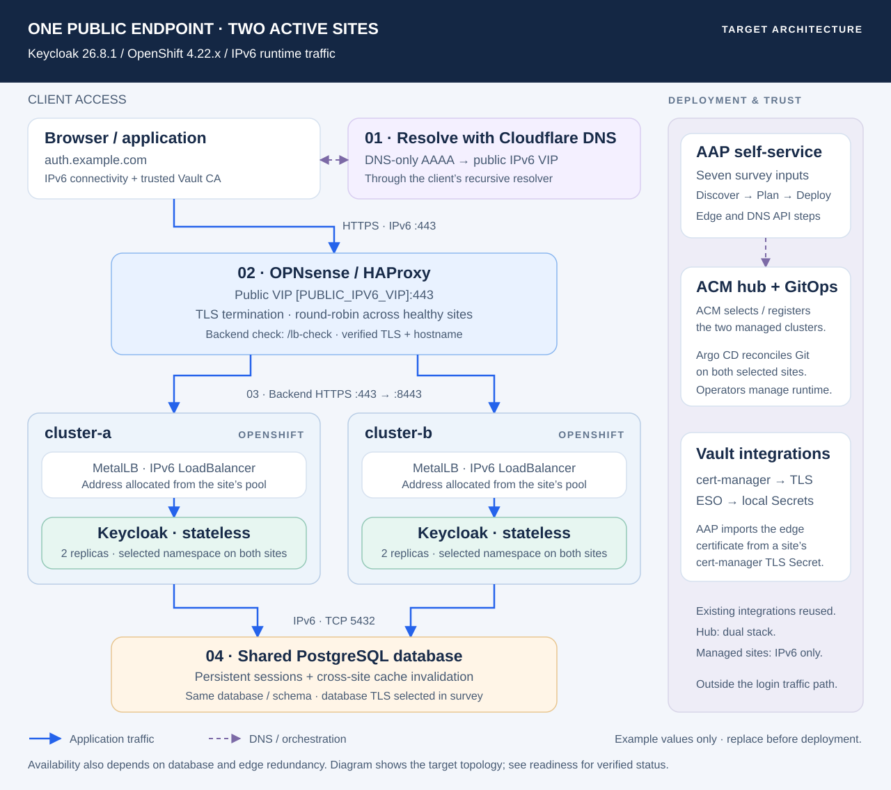
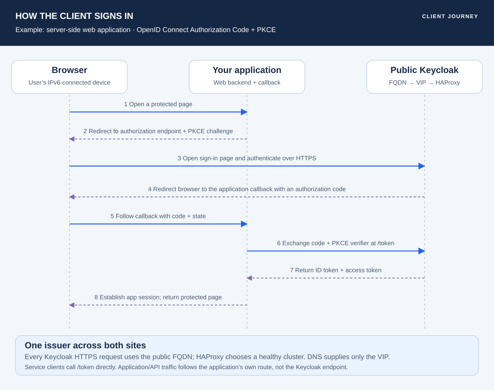

# Architecture and client access

> **Documentation examples:** names, domains and IP addresses are anonymized. Use your own environment values; see [example conventions](examples.md).

[Repository overview](../README.md) · [Deployment runbook](deployment.md) · [Verified readiness](deployment-readiness.md)

The design exposes one Keycloak issuer through two independent OpenShift sites. The public FQDN, IPv6 VIP, namespace and selected cluster pair come from the AAP survey. The diagrams use fictional example values and show the target topology. See the readiness report for verified behavior and outstanding acceptance checks.

[Open full-size SVG](diagrams/architecture.svg)

## From the client to Keycloak

1. **Resolve the name.** The client queries its recursive DNS resolver, which resolves the Cloudflare DNS-only AAAA record. The answer is the OPNsense public VIP, not a managed-cluster address. Cloudflare serves DNS and does not proxy HTTPS in this design. See [DNS-only behavior](https://developers.cloudflare.com/dns/proxy-status/).
2. **Connect over IPv6 HTTPS.** The browser or application connects to the VIP on port 443 and validates the certificate for the public FQDN. A working IPv6 path and trust in the Vault issuing CA are required; publishing DNS does not establish certificate trust.
3. **Select a healthy site.** HAProxy terminates client TLS, applies the hostname and path rules, overwrites forwarded headers and selects a backend using round-robin. It checks each site with `/lb-check` and validates the backend certificate chain and hostname using SNI.
4. **Reach a ready replica.** Each site has its own MetalLB IPv6 LoadBalancer Service. Port 443 forwards to Keycloak 8443. The Service uses `SingleStack` IPv6 and `externalTrafficPolicy: Local`; the operator’s OpenShift ingress is disabled, so this path bypasses Routes.
5. **Read and update shared state.** Both Keycloak sites connect to the same PostgreSQL database/schema over IPv6. The response returns through HAProxy to the caller. The chosen public hostname remains the issuer regardless of which site handles a request.

HAProxy’s backend source address is discovered from OPNsense’s connected interface and is set explicitly. Keycloak trusts that address for forwarded headers. NetworkPolicy templates also admit discovered hub IPv6 sources for automation; effective isolation must be tested across all policies, including policies generated by the Operator. Local caches communicate inside each site. See [Keycloak proxy configuration](https://www.keycloak.org/server/reverseproxy) and [MetalLB traffic policies](https://metallb.io/usage/index.html).

## Browser sign-in and application access

[Open full-size SVG](diagrams/client-access.svg)

The example is a server-side web application using Authorization Code + PKCE. The application redirects the browser to Keycloak. After authentication, Keycloak redirects the browser to the application’s registered callback with a code. The application validates state, exchanges the code and verifier for tokens, validates the returned identity, and establishes its own session. Both browser authentication and backend token exchange use the public Keycloak endpoint. Exact client configuration and application integration are separate from infrastructure deployment. See [Keycloak’s OpenID Connect endpoints](https://www.keycloak.org/securing-apps/oidc-layers).

A machine client using client credentials has no browser redirect: it calls the token endpoint over the same public HTTPS path. Its application/API calls go to that application’s endpoint. Keycloak is the identity provider, not the reverse proxy for every application request.

## Client endpoints

Replace `{realm}` with the application realm. The workflow uses `master` for administrative bootstrap and its synthetic authentication check; it does not create a customer application realm or register customer applications.

| Purpose | Path under the selected public HTTPS FQDN | Access |
| --- | --- | --- |
| Issuer | `/realms/{realm}` | Common identity for both sites |
| OpenID discovery | `/realms/{realm}/.well-known/openid-configuration` | Client configuration |
| Browser authorization | `/realms/{realm}/protocol/openid-connect/auth` | Sign-in redirect |
| Token exchange / client credentials | `/realms/{realm}/protocol/openid-connect/token` | Application or service client |
| Administration | `/admin` | Restricted at HAProxy to the configured management subnet |
| Site health | `/lb-check` | HAProxy backend probe; denied on the public frontend |
| Readiness / metrics | Management port `9000` | Internal probes and monitoring; not exposed by the public Service |

The current management source policy is the WireGuard IPv6 subnet `2001:db8:400:6::/64`. This is a platform setting, not a survey input. For client integration, configure exact permitted redirect URIs and the appropriate client type. A server-side client keeps its client credentials and PKCE verifier on the backend; a browser-only application requires its own suitable client configuration.

## Shared state and availability

The runtime enables `stateless` with two replicas per site. `cache-embedded-cluster-name` uses the selected managed-cluster name, while the Keycloak resource can be named `keycloak` in both clusters. PostgreSQL stores persistent state and carries invalidation between sites. Local embedded caches remain; there is no external Infinispan cluster or inter-site pod cache mesh. `/lb-check` reports site availability; Kubernetes probes report individual node health. See [multi-cluster v2 concepts](https://www.keycloak.org/high-availability/multi-cluster-v2/concepts).

| Failure boundary | Expected behavior / remaining validation |
| --- | --- |
| Keycloak replica | Ready endpoints handle requests; verify scheduling and surviving capacity. Two replicas do not guarantee placement on different nodes. |
| OpenShift site | HAProxy should exclude an unhealthy site after its checks detect failure; validate login, refresh and cache behavior during failover. |
| PostgreSQL writer | Both sites depend on it. Verify database HA, fencing, backup/restore and failure behavior. |
| OPNsense / public VIP | A single appliance remains a single point of failure; appliance redundancy is not created by this workflow. |
| ACM / AAP / Argo CD | New deployments and reconciliation are affected; already-running login traffic does not pass through the hub. |

Upstream multi-cluster requirements include a synchronously replicated HA database, synchronized clocks and commit latency below 10 ms, preferably below 5 ms. Test this environment’s performance and recovery objectives; the presence of two clusters alone does not establish end-to-end availability. See [infrastructure requirements](https://www.keycloak.org/high-availability/multi-cluster-v2/introduction).

Use the [HA acceptance plan](ha-acceptance.md) to validate these failure boundaries with real authentication traffic, controlled faults and measured recovery.

## TLS and credential ownership

| Connection or material | Current implementation |
| --- | --- |
| Client → HAProxy | Public FQDN certificate; clients must trust its Vault CA. |
| HAProxy → Keycloak | Verified HTTPS, CA trust and hostname/SNI checks on both sites. |
| Certificate issuance | Existing native Vault ClusterIssuer `vault-example`; cert-manager requests ECDSA P-256, PKCS8, matching CN and SAN. This cluster issuer uses Vault signing, not ACME challenges. |
| Edge certificate delivery | AAP imports a site’s cert-manager TLS Secret into a project-scoped OPNsense certificate. Continuous renewal delivery is not yet scheduled; deployment/reconcile refreshes it. Existing router ACME integration is not the delivery mechanism used by this workflow. |
| Keycloak → PostgreSQL | Survey `enabled`: verify server trust and hostname. Survey `disabled`: explicitly disable JDBC TLS. Both modes prefer IPv6; a TLS failure never falls back to plaintext. |
| Database / external API credentials | Existing ESO projects the selected database secret and global OPNsense/Cloudflare API credentials into namespace-local Secrets. |
| Administrator bootstrap | The Operator generates the temporary administrator. AAP retains permanent workflow credentials in scoped Kubernetes Secrets, verifies access and removes the temporary administrator user. No bootstrap Vault path is required. |

Bootstrap site A first, establish administration and synthetic token issuance, then start site B against the same database. Do not run competing realm imports or independent configuration controllers against the shared schema. Details and secret field names are in the [survey and credential contract](../automation/aap/SELF-SERVICE.md).

## Management plane

AAP is the self-service entry point. ACM supplies inventory, managed access and the additive Placement/GitOpsCluster registration. Hub Argo CD reconciles six Applications per deployment: operator, prerequisites and runtime for each selected site. Automatic Applications target registered **cluster names**, supporting ACM’s cluster-proxy URLs; AAP uses discovered direct API endpoints for its checks. The operator owns the runtime resources, cert-manager owns certificate issuance and ESO owns secret materialization.

AAP sequences readiness gates and reconciles scoped external HAProxy and Cloudflare objects. Git owns the reviewed configuration; runtime status and allocations are discovered. See [ACM ownership](../automation/acm/README.md), [AAP orchestration](../automation/aap/README.md), and the [readiness report](deployment-readiness.md) for dated live evidence.
